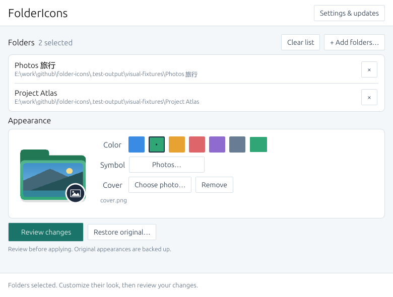
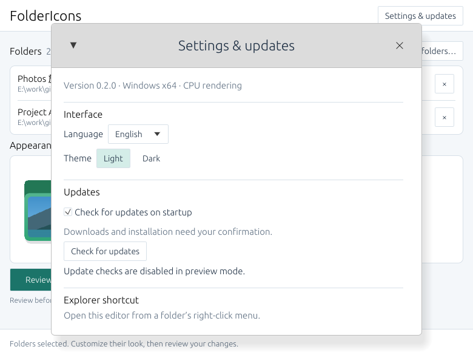
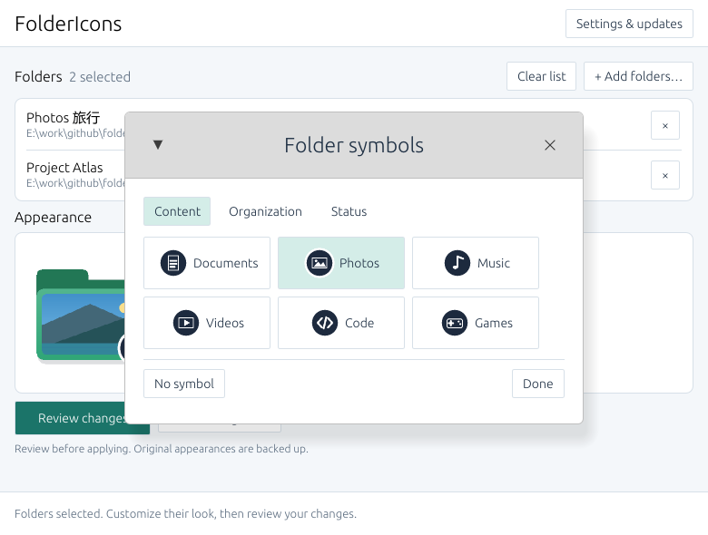

# FolderIcons

An independent Windows desktop tool for original folder colors, badges and photo covers. Built in Rust with an egui desktop interface. MIT licensed. Inspired by the folder-organization use case of [FolderIco](https://www.folderico.com/); no affiliation, copied code or competitor assets.

**Status: local first version with a CPU-rendered interface and verified client-area captures.** Interactive acceptance and the current build's runtime gate are incomplete; an earlier compact build passed bounded idle/hidden diagnostics. No repository or release has been published by this session. Planned canonical repository: [siarheisinelnikau/folder-icons](https://github.com/siarheisinelnikau/folder-icons).

## Capabilities

- Drop folders from Explorer anywhere in the window, or use **Add folders…**. Read-only validation runs on the file worker, skips duplicates/files/unsupported paths and keeps selection within 128 folders. Dropping never moves files or applies icons automatically.
- Six original color themes, custom RGB colors and **17 original folder symbols** (badges), grouped into Content, Organization and Status. The visual picker includes documents, photos, music, videos, code, games, work, downloads, archive, finance, study, travel, lock and status markers. **No symbol** removes the badge.
- PNG/JPEG photo covers with centered crop and an in-app live preview. Photos are embedded in the ICO and are never modified.
- Review an Apply or Restore plan before any appearance change. Each folder has its own result; a failure does not undo successful folders in the batch.
- Generate RGBA ICO files containing 16, 24, 32, 48, 64, 128 and 256 pixel frames.
- Preserve unrelated `desktop.ini` lines/settings. Back up exact original bytes and attributes before changing appearance. Restore the pre-FolderIcons appearance, including an existing custom icon.
- Keep icons and recovery data beside the target folder, in a hidden `.foldericons` directory. Relative icon paths survive application restarts and folder moves when this directory travels with the folder.
- Optional per-user Explorer context menu, enabled and removed explicitly in Settings. No shell extension, service or administrator installation.
- Background startup update checks (on by default, persistent opt-out), manual checks, and user-initiated download, checksum verification, executable replacement and restart.

## Requirements and build

Windows 10/11 x64 is the implementation target. The UI uses **CPU software rasterization and Windows GDI presentation**, with an event loop that waits when idle. No OpenGL/DirectX renderer, runtime model, AI API, WebView or external theme assets are needed. Windows desktop composition remains an OS responsibility. Full interactive support and clean-machine deployment are not yet verified. Network access is used only for enabled update checks and user-requested updates.

The compact 780 × 590 editor puts selected folders above a horizontal appearance panel, with one primary action at each step. Review replaces the editor temporarily instead of repeating the folder list beside it; **Back** returns to editing. Technical file details are available in the review; rendering metrics live under Settings → Diagnostics. Windows' installed Microsoft YaHei font is used as a CJK fallback when available; that system font is not redistributed.

Build with Rust 1.95+ and the MSVC C++ toolchain/Windows SDK:

```powershell
Set-Location E:\work\github\folder-icons
cargo test --locked -j 2
cargo clippy --locked --all-targets -j 2 -- -D warnings
./scripts/package.ps1
```

Build output is repository-local. Cargo is limited to two jobs. The x64 MSVC configuration requests the static CRT. Packaging creates `dist/FolderIcons-v0.1.0.exe`, `FolderIcons-v0.1.0.exe.sha256`, and third-party license notices. Dependency downloads may be required on a fresh machine; `--offline` works with a populated cache. See [verification notes](docs/TESTING.md).

## Use

1. Start the portable EXE from a writable, permanent location.
2. Drag one or several folders from Explorer into the window, or click **Add folders…**. Choose a color, open **Symbol** for the visual picker, and optionally select a photo cover. The preview shows the resulting artwork.
3. Click **Review changes**. Review the exact folders and expand **Files and recovery details** if needed. Unsupported folders are listed as skipped.
4. Click **Apply to folders**. Read each result. Explorer may refresh lazily; reopening the folder or pressing Refresh may be needed. The application sends a targeted shell notification only after an explicit successful action.
5. To undo, select the same folders, click **Restore original…**, then **Restore folders**. Repeated Apply retains the original first backup, rather than replacing it with an already customized state.

Paths passed on the command line preselect folders without changing them. Example: `FolderIcons-v0.1.0.exe "D:\Projects\Sample"`.

The window highlights the drop target while items are dragged over it. New folders are queued if a file operation is already running; duplicate, unsupported and over-limit items are summarized in the status line. A drop returns to the editor and invalidates any existing review, so the changed selection must be reviewed again.

Settings live in `%LOCALAPPDATA%\FolderIcons\settings.json`. **Settings & updates** shows the installed version, startup-check toggle, manual update action, and Explorer integration controls. The context menu opens this editor with a folder selected; on Windows 11 it may appear in **Show more options**. Remove it before moving/deleting the executable, or enable it again from the new location.

## Preservation and recovery

FolderIcons updates the icon keys in `[.ShellClassInfo]`, preserves unrelated text, and writes UTF-16LE with a BOM as required by Windows. Existing UTF-8/ASCII and UTF-16LE INI files are supported. Ambiguous legacy code pages, malformed encodings and duplicate shell sections are refused rather than re-encoded incorrectly. Exact original bytes are kept for Restore.

The application rejects drive roots, symlinks/junctions/reparse points (including cloud placeholders), oversized INI files, unmanaged `.foldericons` directories and stale plans. Read-only/protected/network folders may report permission errors; there is no elevation flow. Local regular folders are the initial intended workload. Cloud sync, network shares, ACL preservation and Explorer caching need manual validation.

If `desktop.ini` changes after Apply, Restore refuses to overwrite it. Keep `.foldericons/manifest.json` and reconcile the changes manually. A write-ahead journal supports retry or Restore after partial operations. It is not a cross-folder transaction or protection against an uncooperative process changing files at exactly the same time. See [architecture and recovery details](docs/ARCHITECTURE.md).

Do not remove `.foldericons` while its icon is in use. To reset an appearance, use Restore first. After an application crash, a stale `.foldericons.lock` can remain in a selected folder; close all FolderIcons processes before removing that one lock file and building a new plan. An unmanaged directory is never automatically claimed or recursively deleted.

## Updates and release preparation

Stable checks use the canonical public GitHub Releases API without tokens. A 404, unpublished repository, network error or rate limit is an unavailable check, never an up-to-date result. Startup errors and no-update results remain in Settings without modal dialogs; an available update appears as a banner.

**Download and install** accepts the matching versioned x64 EXE from the canonical repository. It verifies advertised length, SHA-256 (GitHub asset digest and/or the matching `.exe.sha256` asset), and the x64 PE header before staging. A helper waits for this app to exit, keeps a versioned rollback executable, replaces the running EXE at its existing path, and restarts. Settings and folder backups are outside that replacement. No unattended download/install occurs. This workflow is implemented but has not been executed in this development session; it needs a real published test release and manual validation.

The executable directory must be writable. Rollback files `*.exe.previous-VERSION`, `.FolderIcons-helper-*.exe` and helper `*.error.txt` diagnostics are retained for inspection and can be removed after all FolderIcons processes exit and the update is verified. Interrupted `.FolderIcons-update-VERSION.exe` stages may also need removal before a retry. Release files are unsigned in this initial build. The [release-note draft](CHANGELOG.md) states the validation limits. Publishing is deliberately outside the current task.

## Screenshots

These are real client-area PNGs generated by the application's production UI and CPU rasterizer in an isolated render-save-exit mode. They show disposable fixtures, including a generated sample cover. Captures do not exercise native dialogs, title bars or input handling.



Main editor, 780 × 590 logical pixels at 100% scale. The [review step](docs/screenshots/review.png) shows the exact folders before confirmation.



Settings & updates, the same viewport and scale. The capture performs no network requests or registry changes.



The Content category. Additional [Organization](docs/screenshots/symbols-organization.png) and [Status](docs/screenshots/symbols-status.png) categories use the same original artwork and visual style. The [drop target capture](docs/screenshots/drop.png) shows the drag-hover appearance; it does not certify a physical Explorer drag gesture.

See [verification notes](docs/TESTING.md) for reproducible capture commands, a compact 150% scale view and the remaining interactive checks. Computer use is not required to regenerate these images.
